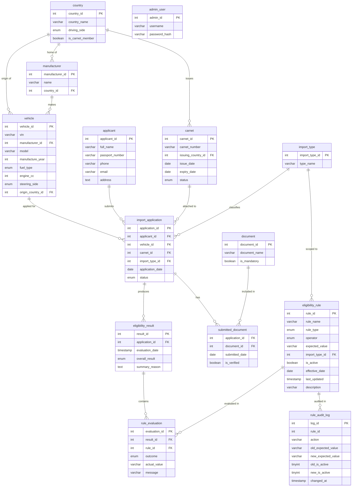

# Indian Vehicle Import Eligibility & Carnet Management System

> **Educational project only.** Verify current import requirements with official Indian
> authorities (DGFT, Customs, Ministry of Road Transport) before making any real import decision.

---

## Project Overview

A full-stack university DBMS project where **the database — not Python — makes all eligibility decisions**.

- A MySQL stored procedure (`CheckEligibility`) evaluates every active rule and stores `PASS/FAIL` per rule.
- Flask is purely a display layer: it calls the procedure and renders the results.
- 14 tables in 3NF, a stored function, 5 triggers, 5 views, parameterized queries everywhere.

**Demo admin login:** `username: admin` | `password: admin123`

---

## Quick Start

### Prerequisites
| Tool | Version |
|---|---|
| Python | 3.11+ |
| MySQL | 8.0 |
| pip | any recent |

### 1. Clone and create `.env`

```bash
git clone https://github.com/YOUR_USERNAME/carnet_import_dbms.git
cd carnet_import_dbms
cp .env.example .env
# Edit .env with your MySQL credentials
```

### 2. Create virtual environment and install dependencies

**Windows:**
```powershell
python -m venv venv
.\venv\Scripts\activate
pip install -r requirements.txt
```

**Mac / Linux:**
```bash
python3 -m venv venv
source venv/bin/activate
pip install -r requirements.txt
```

### 3. Configure `.env`

```ini
DB_HOST=localhost
DB_PORT=3306
DB_USER=root
DB_PASSWORD=your_mysql_password
DB_NAME=carnet_import
SECRET_KEY=change_this_to_a_long_random_string
```

### 4. Create the database (drops and recreates `carnet_import`)

```bash
python setup_db.py
```

### 5. Create the admin user

```bash
python seed_admin.py
```

### 6. Run the Flask development server

```bash
python app.py
```

Open **http://localhost:5000** in your browser.

---

## Environment Variables

| Variable | Description | Default |
|---|---|---|
| `DB_HOST` | MySQL host | `localhost` |
| `DB_PORT` | MySQL port | `3306` |
| `DB_USER` | MySQL username | `root` |
| `DB_PASSWORD` | MySQL password | _(empty)_ |
| `DB_NAME` | Database name | `carnet_import` |
| `SECRET_KEY` | Flask session secret | _(change me)_ |

---

## Demo Admin Login

| Field | Value |
|---|---|
| URL | http://localhost:5000/admin/login |
| Username | `admin` |
| Password | `admin123` |

---

## Manual SQL Demo (Viva)

```sql
-- Connect to MySQL and select the database
USE carnet_import;

-- Manually run the stored procedure (Flask does this in a transaction)
START TRANSACTION;
CALL CheckEligibility(1);
COMMIT;

-- Verify the result
SELECT * FROM eligibility_result WHERE application_id = 1 ORDER BY result_id DESC LIMIT 1;
SELECT * FROM rule_evaluation WHERE result_id = LAST_INSERT_ID();
```

---

## 3NF Justification

### First Normal Form (1NF)
- Every column holds a **single atomic value** — no repeating groups, no arrays.
- Every table has a **primary key** (single-column surrogate `AUTO_INCREMENT`).

### Second Normal Form (2NF)
- Every non-key attribute depends on the **whole** primary key.
- The only composite PK is `submitted_document(application_id, document_id)`, and both non-key columns (`submitted_date`, `is_verified`) depend on the full pair — not just one part.

### Third Normal Form (3NF)
- **No transitive dependencies.** Examples:
  - `manufacturer.country_id` references `country`; driving side and carnet-member status are stored only in `country`, never duplicated in `manufacturer`.
  - `vehicle` links to `manufacturer`; manufacturer name/country are stored only in `manufacturer`.
  - `eligibility_rule.import_type_id` → `import_type.type_name` — the name lives only in `import_type`.
  - Within each table, no non-key column determines another non-key column.

---

## Entity-Relationship Diagram (Mermaid)



---

## SQL Concepts Demonstrated

| Concept | File | Notes |
|---|---|---|
| DDL (CREATE/DROP/ALTER) | `sql/01_schema.sql` | 14 tables, indexes, FKs |
| Stored Function | `sql/02_functions_procedures.sql` | `CalculateVehicleAge()` |
| Stored Procedure | `sql/02_functions_procedures.sql` | `CheckEligibility()` |
| Cursor | `sql/02_functions_procedures.sql` | Loop over active rules |
| CASE expression | `sql/02_functions_procedures.sql`, `06_showcase_queries.sql` | Operator evaluation, age category |
| SIGNAL | `sql/02_functions_procedures.sql` | Error if application not found |
| Triggers (BEFORE/AFTER) | `sql/03_triggers.sql` | 5 triggers |
| Views | `sql/04_views.sql` | 5 views |
| JOIN (INNER + LEFT) | `sql/06_showcase_queries.sql`, `app.py` | 6-table join in reports |
| GROUP BY / HAVING | `sql/06_showcase_queries.sql` | Apps per country, filter > 2 |
| Subquery | `sql/06_showcase_queries.sql` | Vehicles older than avg year |
| EXISTS / NOT EXISTS | `sql/04_views.sql`, `06_showcase_queries.sql` | Missing mandatory docs |
| Transaction (START/COMMIT/ROLLBACK) | `app.py` | Full submission in one transaction |
| Parameterized queries | `app.py`, `db.py` | All queries use `%s` placeholders |
| Indexes | `sql/01_schema.sql` | vin, passport, carnet_number, status |
| 3NF Normalization | `sql/01_schema.sql` | Comment block at top of file |

---

## Viva Q&A

### Q1: Why does CheckEligibility not issue START TRANSACTION?

**A:** MySQL stored procedures that issue `START TRANSACTION` internally would implicitly commit any transaction the caller had already started. By keeping transaction ownership in the **caller** (Flask), we ensure that the insert of applicant → vehicle → application → submitted_documents → CheckEligibility are all part of **one atomic unit**. If `CheckEligibility` fails for any reason, Flask's `ROLLBACK` undoes everything cleanly.

### Q2: What happens if I update a carnet's expiry date to a past date?

**A:** The `trg_carnet_before_update` trigger fires **before** the row is written. It checks `IF NEW.expiry_date < CURDATE()` and sets `NEW.status = 'EXPIRED'` automatically. The update proceeds but the status is corrected without any application-level code.

### Q3: How do you know a rule's expected_value is compared correctly for numeric vs. text types?

**A:** The procedure uses `CAST(v_actual AS DECIMAL(10,2))` for numeric operators (`<`, `<=`, `>`, `>=`) and direct string comparison (`=`, `!=`) for text. The `IN` operator uses `FIND_IN_SET(v_actual, v_cmp)` which treats the expected_value as a comma-separated list (e.g. `PETROL,DIESEL,ELECTRIC,HYBRID`). Rule authors must ensure the expected_value format matches the operator chosen.

---

## Deployment Notes

### Render (Flask + gunicorn)
1. Push to GitHub.
2. Create a **Web Service** on [Render](https://render.com) pointing to your repo.
3. Build command: `pip install -r requirements.txt`
4. Start command: `gunicorn app:app` (already in `Procfile`)
5. Add all `.env` variables in the Render dashboard under **Environment**.

### Railway
1. Create a new project at [Railway](https://railway.app).
2. Add a MySQL plugin and copy the `DATABASE_URL` variables to your `.env` format.
3. Deploy your GitHub repo; Railway auto-detects the `Procfile`.

### Managed MySQL options
- **Aiven** – free tier available (check current offers at aiven.io)
- **Railway MySQL plugin** – included with Railway projects
- **PlanetScale** – MySQL-compatible serverless (check current free tier)

> ⚠️ Free tier policies change frequently. Always check the provider's current pricing page.

---

## Project Structure

```
carnet_import_dbms/
├── app.py                  # Flask application (all routes)
├── db.py                   # Database helper (query, execute, callproc)
├── config.py               # Loads .env variables
├── setup_db.py             # Creates DB, runs all SQL files
├── seed_admin.py           # Creates admin user (werkzeug hashed)
├── requirements.txt
├── Procfile                # gunicorn for deployment
├── .env.example            # Template (copy to .env)
├── .gitignore
├── README.md
├── sql/
│   ├── 01_schema.sql       # 14 tables, 3NF, indexes
│   ├── 02_functions_procedures.sql  # CalculateVehicleAge + CheckEligibility
│   ├── 03_triggers.sql     # 5 triggers
│   ├── 04_views.sql        # 5 views
│   ├── 05_seed.sql         # Seed data + CheckEligibility calls
│   └── 06_showcase_queries.sql  # Named SQL concept demos
├── templates/
│   ├── base.html
│   ├── index.html
│   ├── check.html
│   ├── result.html
│   ├── rules.html
│   ├── about.html
│   └── admin/
│       ├── base_admin.html
│       ├── login.html
│       ├── dashboard.html
│       ├── vehicles.html / vehicle_form.html
│       ├── manufacturers.html / manufacturer_form.html
│       ├── countries.html / country_form.html
│       ├── applicants.html / applicant_form.html
│       ├── carnets.html / carnet_form.html
│       ├── applications.html
│       ├── documents.html / document_form.html
│       ├── rules.html / rule_form.html
│       ├── results.html / result_detail.html
│       ├── reports.html
│       └── auditlog.html
└── static/
```

---

## Git Commands to Push

```bash
# After running setup_db.py and verifying the app works:
git remote add origin https://github.com/YOUR_USERNAME/carnet_import_dbms.git
git push -u origin main
```